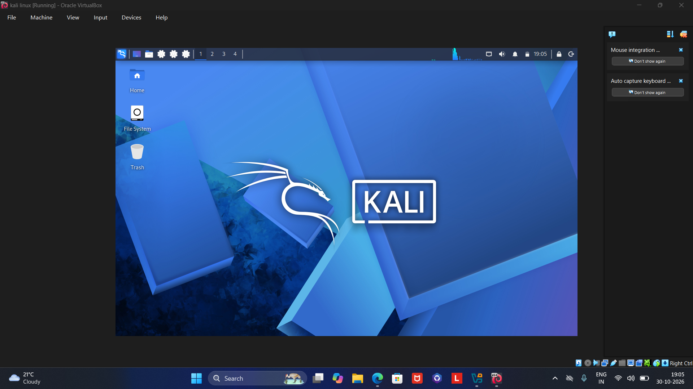
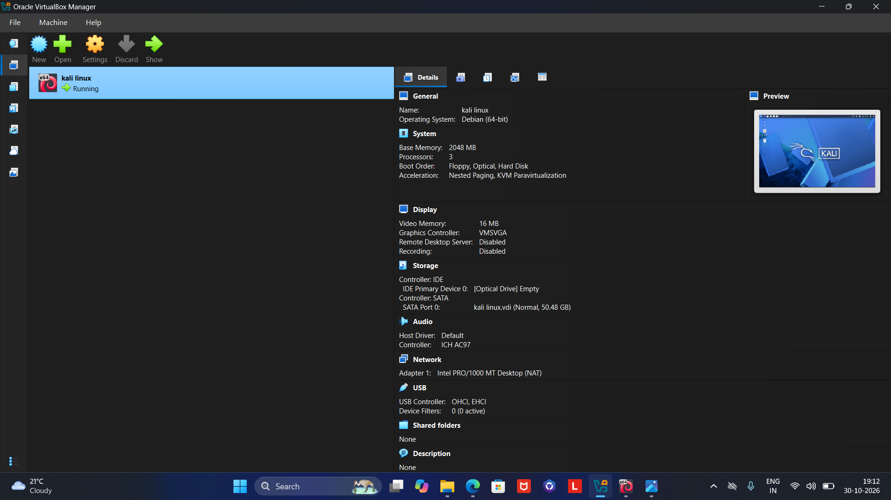
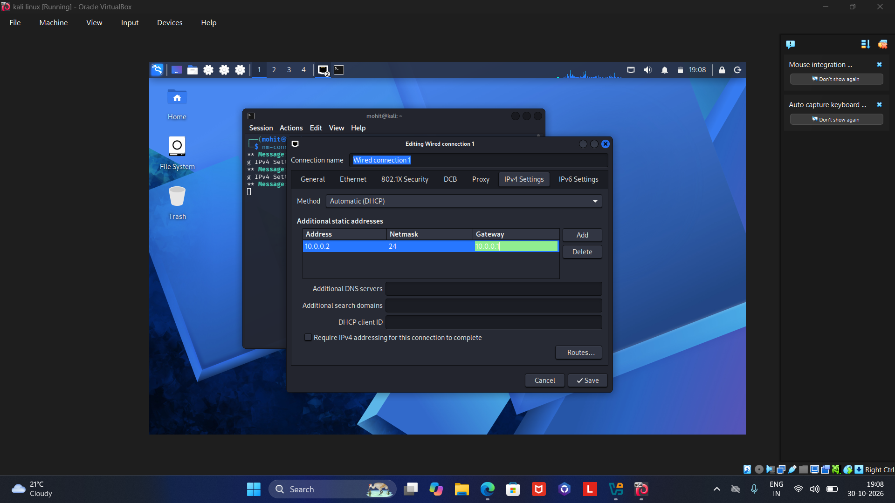
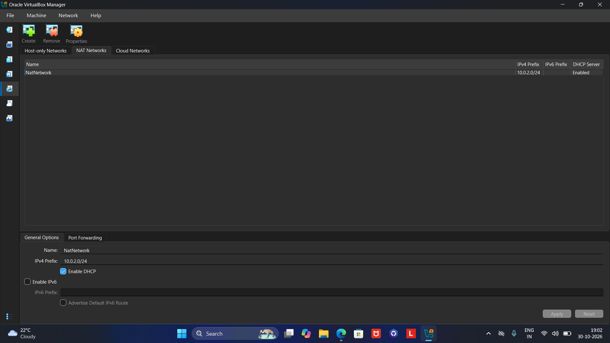

::: {align="center"}
# 🛡️ Kali Linux Virtual Machine Lab

### VirtualBox-Based Cybersecurity Lab Setup & Documentation

**Prepared by: Mohit Kumar**

*Hands-on lab documentation \| Virtualization \| Linux \| Networking*
:::

------------------------------------------------------------------------

## 📌 About This Repository

This repository documents a Virtual Machine (VM) lab setup using
**Oracle VM VirtualBox** and **Kali Linux** on a Windows host machine.

It is maintained as a practical reference for understanding the VM setup
process, reviewing configuration screens, and keeping a visual record of
the lab environment. The repository primarily contains screenshots and
supporting notes from the setup activity.

The documentation is intended to help readers understand the environment
and the steps involved. **Configuration values shown below should be
checked against the actual VM before being treated as final.**

## 🎯 Lab Objectives

-   Understand the fundamentals of virtualization and virtual machines.
-   Set up Oracle VM VirtualBox on a host computer.
-   Create and configure a Kali Linux virtual machine.
-   Review virtual machine resources such as RAM, CPU, and virtual disk.
-   Understand VirtualBox network modes, especially NAT.
-   Inspect Linux network configuration using terminal commands.
-   Maintain screenshots as a visual record of the setup.
-   Build a reusable environment for authorized cybersecurity learning.

## 🏗️ Lab Architecture

The high-level architecture is:

``` text
                 Physical Host Machine
                      Windows 11
                          |
                          |
                Oracle VM VirtualBox
                    (Hypervisor)
                          |
                          |
                  Kali Linux VM
              (Cybersecurity Lab OS)
                          |
                          |
                 VirtualBox Network
                    (NAT Mode)
                          |
                          |
                  External Network
```

> **Architecture note:** This is a conceptual overview of a single Kali
> Linux VM using VirtualBox NAT networking. It does not represent a
> separate Oracle Database VM or a multi-machine network unless those
> components are actually configured in the lab.

Add the architecture image to the repository using the filename
`kali-linux-lab-architecture.png`, then the image will display here:


## 💻 Lab Environment

The following details are based on the configuration information
recorded for this lab. Verify them in VirtualBox and on the host machine
before making changes or using them as a definitive system
specification.

  Component                 Recorded configuration
  ------------------------- ------------------------
  Host operating system     Windows 11
  Host laptop               LOQ 15ARP10E
  Processor                 AMD Ryzen 5 7535HS with Radeon Graphics (3.30 GHz)
  Host RAM                  16 GB
  Virtualization software   Oracle VM VirtualBox
  Guest operating system    Kali Linux
  RAM allocated to VM       8 GB
  Network mode              NAT

### Suggested VM resource checklist

  Setting           Value
  ----------------- -------------------------------------
  VM name           Kali Linux
  Guest OS type     Linux (64-bit)
  RAM               8 GB (recorded; adjust if required)
  CPU cores         Verify in VirtualBox
  Virtual disk      Verify in VirtualBox
  Network adapter   NAT (recorded configuration)

## ⚙️ Setup Procedure

The following is a general reference workflow. The screenshots in this
repository should be used as the visual evidence of the steps that were
actually completed.

1.  **Install VirtualBox**\
    Install Oracle VM VirtualBox on the Windows host machine.

2.  **Obtain the Kali Linux installer**\
    Download the appropriate Kali Linux image from the official Kali
    Linux website.

3.  **Create a virtual machine**\
    Create a new VM in VirtualBox and select the appropriate Linux
    (64-bit) guest type.

4.  **Allocate resources**\
    Assign suitable memory, processor cores, and virtual disk space
    based on the host machine's available resources.

5.  **Attach the installation image**\
    Mount the Kali Linux ISO file to the VM's virtual optical drive.

6.  **Install Kali Linux**\
    Start the VM and follow the installation wizard.

7.  **Configure networking**\
    Select the required VirtualBox network mode. The recorded
    configuration for this lab is NAT.

8.  **Start and verify the VM**\
    Boot into Kali Linux and confirm that the desktop and terminal are
    accessible.

9.  **Capture screenshots**\
    Save screenshots of the relevant VM and network settings for
    documentation.

## 🌐 Network Configuration

The recorded network mode for this VM is **NAT (Network Address
Translation)**.

With NAT, the virtual machine can generally access external networks
through the host machine's network connection. VirtualBox typically
provides the guest with network configuration automatically.

### Useful Kali Linux commands

Check network interfaces and IP addresses:

``` bash
ip a
```

View the routing table:

``` bash
ip route
```

Inspect DNS resolver configuration:

``` bash
cat /etc/resolv.conf
```

Test connectivity to an IP address:

``` bash
ping -c 4 8.8.8.8
```

Test DNS resolution and connectivity:

``` bash
ping -c 4 google.com
```

> **Important:** These are reference commands, not recorded command
> results. Actual IP addresses, gateway, DNS values, and connectivity
> depend on the VM's current network configuration. Do not assume an
> example IP address is the VM's real address.

## 📸 Setup Screenshots

Screenshots are included to provide a visual record of the lab
configuration. Keep the filenames below consistent with the files
uploaded to the repository, or update the links if your filenames
differ.

### 1. Kali Linux Desktop



### 2. VirtualBox VM Overview



### 3. Kali Linux Network Configuration



### 4. VirtualBox Network Configuration



### Screenshot documentation tips

-   Use clear filenames that describe what each screenshot shows.
-   Capture the complete settings window where possible.
-   Avoid including passwords, personal files, license keys, or other
    sensitive information.
-   Add a short caption when a screenshot needs extra explanation.
-   Make sure each image filename in this README exactly matches the
    uploaded file.

## 🧰 Tools and Technologies

  -----------------------------------------------------------------------
  Tool / Technology                   Purpose
  ----------------------------------- -----------------------------------
  Oracle VM VirtualBox                Virtualization platform used to
                                      create and run the VM

  Kali Linux                          Linux distribution used for
                                      cybersecurity learning

  Linux Terminal                      Command-line access and system
                                      inspection

  Nmap                                Network discovery and security
                                      auditing in authorized environments

  Wireshark                           Network traffic analysis in
                                      authorized environments

  Burp Suite                          Web application security testing in
                                      authorized environments
  -----------------------------------------------------------------------

> The tools above describe technologies relevant to the lab's learning
> scope. A tool should only be described as installed or configured
> after confirming it is present in the VM.

## 📚 Learning Outcomes

This lab provides an opportunity to develop practical understanding of:

-   Virtualization concepts and virtual machine management.
-   Installing and starting a Linux guest operating system.
-   Allocating and reviewing VM hardware resources.
-   Basic Linux terminal usage.
-   IP addressing, network interfaces, routing, and DNS.
-   VirtualBox NAT networking.
-   Capturing and organizing technical setup evidence.
-   Maintaining clear and reproducible technical documentation.

## 🔐 Security and Responsible Use

This environment is intended for education and authorized security
testing.

-   Test only systems, networks, and applications that you own or have
    explicit permission to assess.
-   Do not scan or attempt to access third-party systems without
    authorization.
-   Keep the VM and its tools updated.
-   Do not upload passwords, private keys, access tokens, or sensitive
    personal information.
-   Use isolated or intentionally vulnerable lab targets for security
    practice.

## 📁 Suggested Repository Structure

For a clean and easy-to-navigate repository, organize the files like
this:

``` text
kali-linux-vm-lab/
│
├── README.md
├── kali-linux-lab-architecture.png
│
└── screenshots/
    ├── kali-linux.png.png
    ├── VM-Snapshot.png.png
    ├── network-settings-kali.png.png
    └── network-settings.png.png
```

If you use the `screenshots/` folder, update the image links in this
README to include the folder name. For example:

``` markdown

```

## 🔗 Official References

-   [Kali Linux Documentation](https://www.kali.org/docs/)
-   [Kali Linux Downloads](https://www.kali.org/get-kali/)
-   [Oracle VM VirtualBox
    Documentation](https://www.virtualbox.org/manual/)

## 👤 Author

**Mohit Kumar**

*Virtual Machine Lab Setup Documentation*

------------------------------------------------------------------------

::: {align="center"}
**Build · Learn · Practice · Document**

*This repository serves as a visual and technical reference for a Kali
Linux VM lab setup.*
:::
